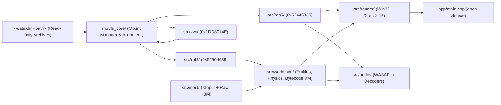

# `open-vfs` Architecture

`open-vfs` is a standalone, clean-room **C++20** and **DirectX 12** desktop runtime designed to mount user-provided local console archive directories (`--data-dir <path>`) and execute their assets natively on Windows 11.

---

## High-Level Dataflow



---

## Subsystem Contracts & Dependency DAG

Each subsystem compiles into an independent CMake static library (`open_vfs_<module>`) with strict one-way dependencies so parallel work never creates cross-module conflicts.

| Target | Source Path | Direct Dependencies | Core Invariants |
| :--- | :--- | :--- | :--- |
| `open_vfs_core` | `src/vfs_core/` | `open_vfs_common` | Bounds-checked little-endian reads; 16-byte sector alignment (`kSectorAlignment = 16`); normalized POSIX-style virtual paths |
| `open_vfs_rpf9` | `src/rpf9/` | `open_vfs_core` | Zero-copy `std::span` parsing of `0x52504639` headers, 16-byte TOC entries, and compressed blocks |
| `open_vfs_rds5` | `src/rds5/` | `open_vfs_core` | `0x52445335` header, 24-byte resource descriptor decoding, and virtual/physical stream page assembly |
| `open_vfs_xvd` | `src/xvd/` | `open_vfs_core` | `0x1DD3014E` / `"msft-xvd"` volume validation, 4096-byte page mapping, and embedded partition enumeration |
| `open_vfs_render` | `src/render/` | `open_vfs_common`, `user32`, `d3d12`, `dxgi` | Native Win32 message pump (plus `--headless` CI mode), DXGI 1.6 swapchain validation, BC texture & mesh upload |
| `open_vfs_audio` | `src/audio/` | `open_vfs_common`, `ole32` | Float32 stereo software mixer with clipping protection, WASAPI shared endpoint, ADPCM/Opus packet decoding |
| `open_vfs_input` | `src/input/` | `open_vfs_common`, `user32` | Circular radial thumbstick deadzone rescaling, Win32 virtual key action mapping, unified KBM + gamepad merge |
| `open_vfs_world_vm` | `src/world_vm/` | `open_vfs_core` | Generational `EntityId` handles (ABA-safe slot reuse), deterministic fixed-timestep clock, physics & script bytecode VM |
| `open-vfs` | `app/main.cpp` | All 8 libraries | CLI argument parsing (`--data-dir`, `--headless`, `--version`), read-only container header probing, desktop game loop |

---

## Container Binary Specifications

<details>
<summary><strong>RPF9 Container Layout (<code>0x52504639</code> / <code>"RPF9"</code>)</strong></summary>

| Offset | Size | Field | Notes |
| :--- | :--- | :--- | :--- |
| `0x00` | `4` | `magic` | `0x52504639` (`"RPF9"`, accepts LE/ASCII FourCC) |
| `0x04` | `4` | `entry_count` | Number of 16-byte TOC entries |
| `0x08` | `4` | `names_length` | Byte length of null-terminated string heap |
| `0x0C` | `4` | `encryption_flags` | Archive payload transform selector |
| `0x10` | `8` | `toc_offset` | 16-byte aligned byte offset to TOC array |
| `0x18` | `8` | `names_offset` | 16-byte aligned byte offset to string heap |

</details>

<details>
<summary><strong>RDS5 Resource Container Layout (<code>0x52445335</code> / <code>"RDS5"</code>)</strong></summary>

| Offset | Size | Field | Notes |
| :--- | :--- | :--- | :--- |
| `0x00` | `4` | `magic` | `0x52445335` (`"RDS5"`) |
| `0x04` | `4` | `version` | Format revision number |
| `0x08` | `4` | `descriptor_count` | Number of 24-byte `Rds5ResourceDescriptor` records |
| `0x0C` | `4` | `chunk_count` | Number of stream chunk index entries |
| `0x10` | `8` | `descriptor_table_offset` | 16-byte aligned offset to descriptor table |
| `0x18` | `8` | `stream_table_offset` | 16-byte aligned offset to stream chunk index |

</details>

<details>
<summary><strong>XVD Virtual Disk Volume Header (<code>0x1DD3014E</code> / <code>"msft-xvd"</code>)</strong></summary>

| Offset | Size | Field | Notes |
| :--- | :--- | :--- | :--- |
| `0x00` | `8` | `signature` | ASCII `"msft-xvd"` |
| `0x08` | `4` | `magic` | `0x1DD3014E` |
| `0x0C` | `4` | `format_version` | XVD header format version |
| `0x10` | `4` | `page_size` | Logical page size in bytes (typically `4096`, 16-byte aligned) |
| `0x14` | `4` | `partition_count` | Number of embedded partition records |
| `0x18` | `8` | `drive_size` | Total virtual drive byte length |
| `0x20` | `8` | `data_offset` | 16-byte aligned offset to logical data pages |
| `0x28` | `8` | `hash_tree_offset` | Offset to integrity hash tree root |
| `0x30` | `8` | `userdata_offset` | Offset to embedded user-data metadata segment |

</details>

---

## Automated Progress Tracking & Verification

Every function definition in `src/` carries `OPEN_VFS_IMPL` or `OPEN_VFS_STUB` from `include/open_vfs/macros.hpp`. On every push to `main`, `.github/workflows/progress.yml` compiles `open-vfs.exe`, runs all 8 CTest binaries, regenerates `progress.svg` via `tools/progress.py`, and deploys the live dashboard to GitHub Pages.

<details>
<summary><strong>Local Verification Commands</strong></summary>

```powershell
cmake -B build -G "Visual Studio 17 2022" -A x64
cmake --build build --config Release --parallel
ctest --test-dir build -C Release --output-on-failure
python tools/progress.py --scan
```

</details>
