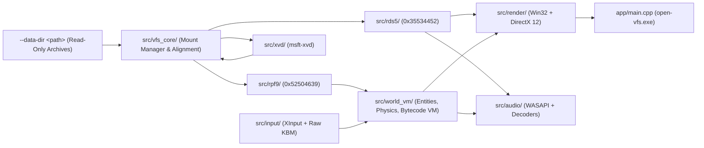

# `open-vfs` Architecture

`open-vfs` is a standalone, clean-room **C++20** and **DirectX 12** desktop runtime designed to mount user-provided local console archive directories (`--data-dir <path>`) and execute their assets natively on Windows 11.

---

## High-Level Dataflow



---

## Subsystem Contracts & Dependency DAG

Each subsystem compiles into an independent CMake static library (`open_vfs_<module>`) with strict one-way dependencies so parallel work never creates cross-module conflicts.

| Target | Source Path | Direct Dependencies | Core Invariants |
| :--- | :--- | :--- | :--- |
| `open_vfs_core` | `src/vfs_core/` | `open_vfs_common` | Bounds-checked little-endian reads; 16-byte sector alignment (`kSectorAlignment = 16`); normalized POSIX-style virtual paths |
| `open_vfs_rpf9` | `src/rpf9/` | `open_vfs_core` | Zero-copy `std::span` parsing of `0x52504639` headers, 16-byte TOC entries, and compressed blocks |
| `open_vfs_rds5` | `src/rds5/` | `open_vfs_core` | 16-byte `"RDS5"` (`0x35534452`) header, 8-byte LE chunk descriptor bitfields, EOF sentinel validation, and Chunk 0 `ETPF` resource table parsing |
| `open_vfs_xvd` | `src/xvd/` | `open_vfs_core` | `0x1DD3014E` / `"msft-xvd"` volume validation, 4096-byte page mapping, and embedded partition enumeration |
| `open_vfs_render` | `src/render/` | `open_vfs_common`, `user32`, `d3d12`, `dxgi` | Native Win32 message pump (plus `--headless` CI mode), DXGI 1.6 swapchain validation, BC texture & mesh upload |
| `open_vfs_audio` | `src/audio/` | `open_vfs_common`, `ole32` | Float32 stereo software mixer with clipping protection, WASAPI shared endpoint, ADPCM/Opus packet decoding |
| `open_vfs_input` | `src/input/` | `open_vfs_common`, `user32` | Circular radial thumbstick deadzone rescaling, Win32 virtual key action mapping, unified KBM + gamepad merge |
| `open_vfs_world_vm` | `src/world_vm/` | `open_vfs_core` | Generational `EntityId` handles (ABA-safe slot reuse), deterministic fixed-timestep clock, physics & script bytecode VM |
| `open-vfs` | `app/main.cpp` | All 8 libraries | CLI argument parsing (`--data-dir`, `--headless`, `--version`), read-only container header probing, desktop game loop |

---

## Verified On-Disk Container Layouts

Read-only header inspection of real local archive containers establishes the following little-endian binary invariants:

- **RPF9 (LE):**
  - **64-byte plaintext header `[0x00..0x40)`:** `+0x00` `magic = 0x52504639` (bytes `39 46 50 52`), `+0x04` `metadata_end_offset`, `+0x08` `region_b_offset`, `+0x0C` `tail_table_size`, `+0x18` `0x00047A00`, `+0x1C` `region_a_offset = 0x150`, `+0x24` `entry_count`, `+0x28` key-profile tag, `+0x2C` `index_width` (`1` if `entry_count <= 255` else `2`), `+0x30` alignment (`0x10`).
  - **272-byte crypto block `[0x40..0x150)`.**
  - **Metadata & payload regions:** Encrypted Region A `[0x150..region_b_offset)`, encrypted Region B `[region_b_offset..metadata_end_offset)` with size `ALIGN_UP(entry_count * (8 + index_width), 16)` when `u16[+0x22] == 1`, mixed plaintext/encrypted payloads, and encrypted EOF Region C `[file_size - tail_table_size..file_size)`.
  - **Verified unencrypted payloads & `SGD5`:**
    - **`SGD5` shader group databases:** `53 47 44 35` header + parameter groups + global bindings + shader records holding raw RFC 1951 deflate streams that decompress to standard `DXBC` containers with Shader Model 6.x `DXIL` bytecode.
    - **`PSIN` (PSO v2 IFF chain):** `PSIN -> LSCH -> LENM -> LSNS -> LGID -> LRSC -> CHKS`.
    - **Plaintext UTF-8 XML configs** and nested `RPF9` / RFC 1950 zlib streams.
    - **`RSC` / `pgBase` resource graphs:** segmented virtual (`0x50xxxxxx`) and physical (`0x60xxxxxx`) pointers.
    - **`ADAT` / `AWC` wave containers:** uncompressed wave containers (`41 44 41 54`).
    - **`PS\0\x09` pipeline state caches.**

- **RDS5 (LE, unencrypted):**
  - **16-byte fixed header `[0x00..0x10)`:** `+0x00` `u32` `"RDS5"` (`0x35534452`, bytes `52 44 53 35`), `+0x04` `u32` `descriptor_count = chunk_count + 1` (`>= 2`), `+0x08` 56-bit LE `total_uncompressed_size` (4 KiB-aligned), `+0x0F` `u8` `max_chunk_shift = 0x16` (`log2(4 MiB)`).
  - **8-byte `uint64_t` LE chunk descriptors `[0x10, 0x10 + descriptor_count * 8)`:**
    - `bits [0..25]`: `disk_offset = (desc & 0x03FFFFFFULL) << 8` (256-byte units)
    - `bits [26..29]`: `codec_id = (desc >> 26) & 0xFULL` — `0x0` raw uncompressed; `0x8` RFC 1950 zlib (`78 DA`, ~89.4% of chunks, carrying raw GPU texture surfaces/mip tails with no internal DDS/RSC wrapper); `0x1..0x7` map 1-to-1 to hardware BCPack (`BC1`..`BC7`, with per-chunk selection independent of `ETPF`)
    - `bits [30..51]`: `virtual_offset = ((desc >> 30) & 0x3FFFFFULL) << 12` (4 KiB page units)
    - `bits [52..63]`: `trailing_padding = (desc >> 52) & 0xFFFULL` (`0..4,095` bytes)
  - **Sentinel & alignment:** Final descriptor (`descriptor_count - 1`) is an EOF sentinel (`disk_offset == file_size`, `virtual_offset == total_uncompressed_size`). Each chunk `i` in `[0 .. descriptor_count - 2]` has `disk_span = disk_offset[i+1] - disk_offset[i]`, `stored_size = disk_span - trailing_padding`, and `uncompressed_size = virtual_offset[i+1] - virtual_offset[i] <= (1ULL << max_chunk_shift)`. The descriptor table is zero-padded up to `ALIGN_UP(0x10 + descriptor_count * 8, 0x100)` (`0x100` for `<= 30` descriptors) where Chunk 0 starts.
  - **Chunk 0 `ETPF` resource table:** Chunk 0 (`codec_id == 0x0`, `virtual_offset == 0`) holds an unencrypted `ETPF` GPU texture table where `ETPF[+0x0C]` is `aux_pool_size` (`S_aux`, a 16-byte-aligned byte length, **not** an offset). Exact Chunk 0 layout (`N = entry_count`, total active span `0x10 + 32*N + S_aux <= chunk0_size`):
    - `[+0x00, +0x10)`: 16-byte header (`"ETPF"` = `0x46505445`, version `0x0000027A`, `u32` `entry_count` = `N`, `u32` `aux_pool_size` = `S_aux`, `S_aux % 16 == 0`).
    - `[+0x10, +0x10 + 16*N)`: primary 16-byte GPU texture descriptors (monotonic non-decreasing by `virt_page`):
      - `w0` (`+0x00`): `width = (w0 & 0x3FFF) + 1`, `height = ((w0 >> 14) & 0x3FFF) + 1`, `tail_mip_count = (w0 >> 28) & 0xF`.
      - `w1` (`+0x04`): `streamed_mip_count = w1 & 0x7`, `dxgi_format = (w1 >> 3) & 0x7F`, `depth_or_slices = ((w1 >> 10) & 0x3F) + 1`, `dimension_flags = (w1 >> 21) & 0x7` (`1`=2D, `2`=Cube, `3`=3D, `5`=2DArray), `packed_tier_count = (w1 >> 24) & 0x7`, `is_cube_tile_flag = (w1 >> 27) & 1`, `aux_flag_10 = (w1 >> 28) & 1`.
      - `q23` (`+0x08`): `virt_page = q23 & 0x1FFFFF`, four 5-bit `chunk_size_codes[0..3]` at bits `[21..40]` (4 KiB page-count hint table: `0` = absent, `1..8` = `1..8` pages, `10..16` = `12, 16, 24, 32, 48, 64, 128` pages, `21..24` = `18, 80, 96, 144` pages, `26..28` = `272, 384, 528` pages; codes `9`, `17..20`, `25`, `29..31` unobserved; RDS5 chunk descriptors remain authoritative for exact per-chunk `uncompressed_size`), `sub64k_chunk_count = (q23 >> 51) & 0x3`, `tile0_free_pages = (q23 >> 53) & 0xF`.
    - `[+0x10 + 16*N, +0x10 + 24*N)`: strictly ascending `u64` resource keys (sharded across multi-archive sets by low `k` bits).
    - `[+0x10 + 24*N, +0x10 + 32*N)`: opaque / high-entropy secondary 8-byte-per-entry region.
    - `[+0x10 + 32*N, +0x10 + 32*N + S_aux)`: 16-byte-aligned auxiliary pool.
    - Trailing zero padding to the 4 KiB Chunk 0 boundary.

- **XVD (LE, v3):**
  - **3-page header `[0x0000..0x3000)`:** 512-byte signature block `[0x000..0x200)`, `"msft-xvd"` at `+0x200`, `VolumeFlags` at `+0x208`, `FormatVersion = 3` at `+0x20C`, `DriveSize` at `+0x218`, and `TopHashBlockHash` (SHA-256 of page at `0x3000`) at `+0x240`.
  - **Integrity tree & data:** Plaintext 3-level SHA-256 Merkle tree (170 x 24-byte entries per 4 KiB page; Level-0 leaves = 20-byte truncated SHA-256 + `u32` LE `block_index`), followed by encrypted 4 KiB data pages.

- **PRI (LE, unencrypted):**
  - Standard MRM/PRI2 (`"mrm_pri2"` header/footer, 32-byte section TOC, `[mrm_decn_info]`, `[mrm_pridescex]`, `[mrm_hschemaex]`, `[mrm_res_map2_]`, `[mrm_dataitem]`), platform packaging metadata only.

---

## Container Binary Specifications

<details>
<summary><strong>RPF9 Container Layout (<code>0x52504639</code> / bytes <code>39 46 50 52</code>)</strong></summary>

> Note: `src/rpf9/` is still migrating from its initial scaffold header to the verified 64-byte plaintext header + 272-byte crypto block layout documented above.

| Offset | Size | Field | Notes |
| :--- | :--- | :--- | :--- |
| `0x00` | `4` | `magic` | `0x52504639` (bytes `39 46 50 52` LE) |
| `0x04` | `4` | `metadata_end_offset` | End offset of encrypted Region B |
| `0x08` | `4` | `region_b_offset` | Start offset of encrypted Region B |
| `0x0C` | `4` | `tail_table_size` | Size of encrypted EOF Region C |
| `0x18` | `4` | `format_tag` | `0x00047A00` |
| `0x1C` | `4` | `region_a_offset` | `0x150` (immediately after 272-byte crypto block) |
| `0x22` | `2` | `region_b_flag` | When `1`, Region B size is `ALIGN_UP(entry_count * (8 + index_width), 16)` |
| `0x24` | `4` | `entry_count` | Number of archive entries |
| `0x28` | `4` | `key_profile` | Key-profile selector tag |
| `0x2C` | `4` | `index_width` | `1` if `entry_count <= 255` else `2` |
| `0x30` | `4` | `alignment` | `0x10` (16-byte alignment) |

</details>

<details>
<summary><strong>RDS5 Resource Container Layout (<code>0x35534452</code> / <code>"RDS5"</code>) &amp; Chunk 0 <code>ETPF</code> Table</strong></summary>

| Offset | Size | Field | Notes |
| :--- | :--- | :--- | :--- |
| `0x00` | `4` | `magic` | `0x35534452` (ASCII `"RDS5"` LE) |
| `0x04` | `4` | `descriptor_count` | `chunk_count + 1` (`>= 2`, includes EOF sentinel) |
| `0x08` | `7` | `total_uncompressed_size` | 56-bit LE total virtual byte size (4 KiB-aligned) |
| `0x0F` | `1` | `max_chunk_shift` | `0x16` (`log2(4 MiB)`) |
| `0x10` | `8 * D` | `descriptors[D]` | Contiguous 64-bit LE bitfield chunk descriptors (`D = descriptor_count`) |

**Chunk 0 `ETPF` Layout (`N = entry_count`, `S_aux = aux_pool_size`, `S_aux % 16 == 0`):**

| Chunk 0 Offset | Size | Region | Notes |
| :--- | :--- | :--- | :--- |
| `+0x00` | `16` | `EtpfHeader` | `magic = "ETPF"` (`0x46505445`), `version = 0x27A`, `entry_count = N`, `aux_pool_size = S_aux` |
| `+0x10` | `16 * N` | Primary texture descriptors | 16-byte GPU texture descriptors (`w0`, `w1`, `q23`), monotonic non-decreasing by `virt_page` |
| `+0x10 + 16*N` | `8 * N` | Resource key table | Strictly ascending `u64` LE resource keys (sharded across archive sets by low `k` bits) |
| `+0x10 + 24*N` | `8 * N` | Secondary region | Opaque / high-entropy 8-byte-per-entry table |
| `+0x10 + 32*N` | `S_aux` | Auxiliary pool | 16-byte-aligned trailing auxiliary bytes (`0x10 + 32*N + S_aux <= chunk0_size`), followed by zero padding to 4 KiB |

</details>

<details>
<summary><strong>XVD Virtual Disk Volume Header (<code>"msft-xvd"</code>, Format v3)</strong></summary>

> Note: `src/xvd/` is still migrating from its initial scaffold header to the verified 3-page v3 header + 3-level SHA-256 Merkle tree layout documented above.

| Offset | Size | Field | Notes |
| :--- | :--- | :--- | :--- |
| `0x000` | `512` | `signature_block` | Cryptographic header signature block |
| `0x200` | `8` | `magic` | ASCII `"msft-xvd"` |
| `0x208` | `4` | `volume_flags` | `VolumeFlags` bitmask |
| `0x20C` | `4` | `format_version` | `3` (XVD v3) |
| `0x218` | `8` | `drive_size` | Total virtual drive byte length (`DriveSize`) |
| `0x240` | `32` | `top_hash_block_hash` | SHA-256 digest of the root hash tree page at `0x3000` |

</details>

---

## Automated Progress Tracking & Verification

Every function definition in `src/` carries `OPEN_VFS_IMPL` or `OPEN_VFS_STUB` from `include/open_vfs/macros.hpp`. On every push to `main`, `.github/workflows/progress.yml` compiles `open-vfs.exe`, runs all 8 CTest binaries, regenerates `progress.svg` via `tools/progress.py`, and deploys the live dashboard to GitHub Pages.

<details>
<summary><strong>Local Verification Commands</strong></summary>

```powershell
cmake -B build -G "Visual Studio 17 2022" -A x64
cmake --build build --config Release --parallel
ctest --test-dir build -C Release --output-on-failure
python tools/progress.py --scan
```

</details>
