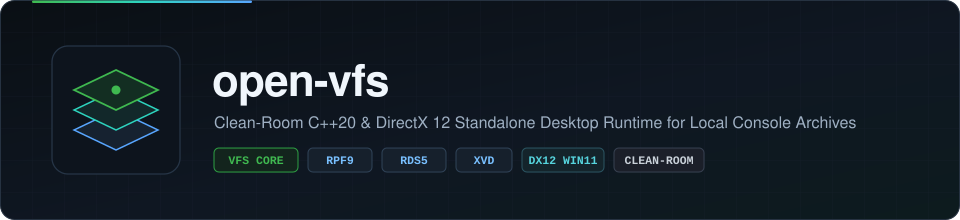
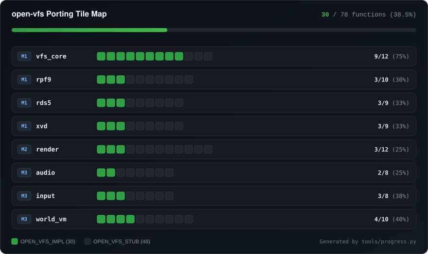

<p align="center">
  
</p>

<p align="center">
  <a href="https://github.com/penwin2000/open-vfs/actions/workflows/progress.yml"></a>
  
  
  
  <a href="./LICENSE"></a>
</p>

<h3 align="center">Porting the matching Xbox game to run natively on Windows 11 PC.</h3>

<p align="center">
  <a href="#the-goal"><strong>The Goal</strong></a>
  &nbsp;&middot;&nbsp;
  <a href="#help-build-it-with-one-prompt"><strong>Contribute in One Prompt</strong></a>
  &nbsp;&middot;&nbsp;
  <a href="#check-if-your-folder-matches"><strong>Check Your Folder</strong></a>
  &nbsp;&middot;&nbsp;
  <a href="#road-to-playable-on-pc"><strong>Roadmap</strong></a>
  &nbsp;&middot;&nbsp;
  <a href="#try-it-on-windows-11"><strong>Try It</strong></a>
  &nbsp;&middot;&nbsp;
  <a href="#for-developers"><strong>For Developers</strong></a>
</p>

<br>

<p align="center">
  <a href="https://penwin2000.github.io/open-vfs/">
    
  </a>
</p>

<p align="center">
  <sub>Green squares are finished parts of the PC port. Dark squares are still left to build. Click the map for the live interactive view.</sub>
</p>

<br>

---

<br>

## The Goal

**`open-vfs`** is an open community project with one clear mission: **port the Xbox game that matches our expected folder layout so it runs natively on PC (Windows 11)** as a standalone app (`open-vfs.exe`).

You bring your own local copy of the Xbox game folder ([check if your folder matches](#check-if-your-folder-matches)). When you launch `open-vfs.exe`, it automatically checks that your folder matches the right layout, reads the game files directly from your drive without modifying them, and rebuilds the graphics, audio, controls, and world simulation natively for Windows 11 with DirectX 12.

<br>

> [!IMPORTANT]
> **100% Clean-Room & Legal.** This repository contains zero copyrighted game files, binaries, keys, or commercial game titles. Every line of code here is written from scratch so anyone can safely share improvements and help finish the PC port.

<br>

---

<br>

## Help Build It With One Prompt

**You do not need to know how to code to help port this game to PC.** If you have the matching Xbox game folder on your computer, you can contribute a real piece of the Windows 11 port using **any AI coding harness** (Claude Code, Codex, Cursor, Windsurf, Gemini CLI, GitHub Copilot, Antigravity, or any similar coding agent).

Copy and send this single short prompt inside your AI coding tool:

```text
Set up https://github.com/penwin2000/open-vfs and start contributing
```

<br>

| Step 1: Open Your Game Folder | Step 2: Send the Short Prompt | Step 3: Let Your AI Build & Submit |
| :--- | :--- | :--- |
| Open your local Xbox game folder in **any AI coding harness** while signed in to GitHub (`gh`). | Paste the short prompt above and press Enter. Nothing else is required from you. | Your AI reads our built-in instructions (`AGENTS.md` and `CONTRIBUTING.md`), clones into a separate `.open-vfs-repo/` folder, picks one dark square from the map above, inspects tiny file headers read-only, writes the new Windows 11 code and tests, and opens a Pull Request. |

<br>

> [!TIP]
> **Your private files never leave your PC.** Every harness follows strict read-only rules so your game files are never copied or uploaded, and our automated `PR Guard` checks every Pull Request before merge. Prefer contributing manually as a C++ developer? Follow the walkthrough in [CONTRIBUTING.md](./CONTRIBUTING.md) and [AGENTS.md](./AGENTS.md).

<br>

---

<br>

## Check If Your Folder Matches

Not sure if you have the right Xbox game folder? You can check in two seconds using Windows Terminal without downloading anything.

<br>

| Step 1: Open Terminal in Your Folder | Step 2: Paste & Run the Check |
| :--- | :--- |
| Open your Xbox game folder in File Explorer, right-click an empty spot inside it, and select **Open in Terminal**. | Copy the command below, paste it into Terminal, and press Enter. It reads only tiny file headers (read-only) and prints green **`MATCH`** if your folder matches. |

<br>

```powershell
$c=@{RPF9=0;RDS5=0;XVD=0;PRI=0}; $b=New-Object byte[] 528; $e=[Text.Encoding]::GetEncoding(28591); Get-ChildItem -Recurse -File -EA 0 | Where-Object { $_.DirectoryName.Substring($PWD.Path.Length) -notmatch '(^|[\\/])\.' } | ForEach-Object { $fs=$null; try { $fs=[IO.File]::OpenRead($_.FullName); $n=$fs.Read($b,0,528); if($n -ge 4){ $s=$e.GetString($b,0,$n); $m=$s.Substring(0,4); if($m -cin 'RPF9','9FPR'){$c.RPF9++} elseif($m -cin 'RDS5','5SDR'){$c.RDS5++} elseif($n -ge 8 -and $s.Substring(0,8) -cmatch '^mrm_(pri[0123f]|vnxt)$'){$c.PRI++} elseif(($n -ge 8 -and $s.Substring(0,8) -ceq 'msft-xvd') -or ($n -ge 12 -and [BitConverter]::ToUInt32($b,0) -eq 0x1DD3014E -and $s.Substring(4,8) -ceq 'msft-xvd') -or ($n -ge 520 -and $s.Substring(512,8) -ceq 'msft-xvd')){$c.XVD++} } } catch {} finally { if($fs){$fs.Dispose()} } }; $id="RPF9=$($c.RPF9) RDS5=$($c.RDS5) XVD=$($c.XVD) PRI=$($c.PRI)"; if($id -eq 'RPF9=22 RDS5=57 XVD=1 PRI=1'){ Write-Host "MATCH ($id)" -ForegroundColor Green } else { Write-Host "NO MATCH ($id)" -ForegroundColor Red }
```

<br>

> [!NOTE]
> **Already downloaded `open-vfs.exe`?** You can run the exact same built-in check with `.\open-vfs.exe --data-dir "path\to\your\game_folder" --headless` and look for `[vfs] Data layout verified`.

<br>

---

<br>

## Road to Playable on PC

We are building the PC port in four clear stages, matching the `M1` through `M4` rows on the progress map above.

<br>

| Stage | What It Unlocks on Windows 11 | Modules |
| :--- | :--- | :--- |
| **[Stage 1: Reading the Game Files (M1)](https://github.com/penwin2000/open-vfs/milestone/1)** | Opens and unpacks the Xbox game's archive containers cleanly on Windows. | `vfs_core`, `rpf9`, `rds5`, `xvd` |
| **[Stage 2: Graphics & Display (M2)](https://github.com/penwin2000/open-vfs/milestone/2)** | Opens a native Windows 11 window and draws textures and 3D worlds with DirectX 12. | `render` |
| **[Stage 3: Sound, Controls & World (M3)](https://github.com/penwin2000/open-vfs/milestone/3)** | Plays Windows audio, supports Xbox controllers plus keyboard and mouse, and runs physics and game scripts. | `audio`, `input`, `world_vm` |
| **[Stage 4: Playable on PC (M4)](https://github.com/penwin2000/open-vfs/milestone/4)** | Connects every system together for smooth 60+ FPS gameplay on Windows 11. | Full PC integration |

<br>

---

<br>

## Try It on Windows 11

You can test the latest build right away with no programming tools installed, or compile `open-vfs.exe` locally from source.

<br>

| Option | Best For | How to Get It | What You Need |
| :--- | :--- | :--- | :--- |
| **Ready-Made App (Prebuilt)** | Trying `open-vfs.exe` right away against your local game folder | Download `open-vfs.exe` from [GitHub Releases](https://github.com/penwin2000/open-vfs/releases) or the latest `open-vfs-win64` artifact on [`main` CI runs](https://github.com/penwin2000/open-vfs/actions/workflows/progress.yml?query=branch%3Amain) | Windows 11 (64-bit) and a DirectX 12 GPU |
| **Build From Source** | Developing modules, testing edits, or running the local test suite | Clone this repository and compile Release with CMake and Visual Studio 2022 | Visual Studio 2022+ (C++20) and CMake 3.25+ |

<br>

Point `open-vfs.exe` at your local Xbox game folder to run it:

```powershell
.\open-vfs.exe --data-dir "path\to\your\game_folder"
```

At startup, `open-vfs.exe` inspects your folder read-only and exits cleanly with `ErrUnsupportedDataLayout` if the directory does not match the expected Xbox game layout.

<br>

---

<br>

## For Developers

Expand any section below for technical requirements, module layout, and local build or test commands.

<br>

<details>
<summary><strong>System Requirements</strong></summary>

<br>

| Requirement | Minimum / Supported | Notes |
| :--- | :--- | :--- |
| **Operating System** | Windows 11 (x64) | Native Win32 + DXGI 1.6 desktop target |
| **Build System** | CMake 3.25+ | Generates Visual Studio or Ninja build trees |
| **C++ Toolchain** | MSVC (VS 2022) or Ninja + Clang/MSVC | Strict C++20 (`/W4 /permissive-`) |
| **Graphics Hardware** | DirectX 12 Feature Level 12_0+ GPU | Hardware swapchain & pipeline execution |
| **Scripting** | Python 3.10+ | Standard-library-only `tools/progress.py` scanner |
| **Collaboration CLI** | GitHub CLI (`gh`) | Automated Issue -> Branch -> Milestone -> PR flow |

<br>

</details>

<br>

<details>
<summary><strong>Subsystem Architecture (8 Isolated Modules)</strong></summary>

<br>

Source code is split into eight isolated static library modules so multiple contributors and AI harnesses can work in parallel without merge conflicts. See [ARCHITECTURE.md](./ARCHITECTURE.md) for binary layouts and dependency diagrams.

<br>

| Module | Directory | Responsibility | Milestone |
| :--- | :--- | :--- | :--- |
| **VFS Core** | `src/vfs_core/` | Virtual mount manager, path resolver, little-endian readers, 16-byte alignment checks | `M1` |
| **RPF9 Parser** | `src/rpf9/` | `0x52504639` (`"RPF9"`) container headers, TOC entries, and compressed blocks | `M1` |
| **RDS5 Parser** | `src/rds5/` | `0x52445335` (`"RDS5"`) headers, resource descriptors, and stream chunks | `M1` |
| **XVD Parser** | `src/xvd/` | `0x1DD3014E` (`"msft-xvd"`) virtual disk volume headers and embedded partitions | `M1` |
| **DX12 Render** | `src/render/` | Native Win32 window loop, DirectX 12 swapchain, texture decoder, and mesh renderer | `M2` |
| **Audio Engine** | `src/audio/` | Windows WASAPI audio mixer and compressed audio stream decoder | `M3` |
| **Input Mapper** | `src/input/` | Gamepad (XInput), Raw Input mouse, and keyboard action mapper | `M3` |
| **World VM** | `src/world_vm/` | Generational entity registry, world loader, physics step, and script bytecode VM | `M3` / `M4` |
| **Desktop App** | `app/main.cpp` | `open-vfs.exe` entry point mounting `--data-dir` and driving the simulation loop | All |

<br>

</details>

<br>

<details>
<summary><strong>Build, Test &amp; Progress Commands</strong></summary>

<br>

**Configure & build with MSVC (Visual Studio 2022):**

```powershell
cmake -B build -A x64
cmake --build build --config Release -- /m:1 /nr:false
```

<br>

**Configure & build with Ninja (Developer PowerShell):**

```powershell
cmake -B build -G Ninja -DCMAKE_BUILD_TYPE=Release
cmake --build build
```

<br>

**Run synthetic-buffer unit tests & headless probe:**

```powershell
ctest --test-dir build -C Release --output-on-failure
.\build\Release\open-vfs.exe --data-dir "path\to\your\game_folder" --headless
```

<br>

**Scan implementation progress & regenerate `progress.svg`:**

```powershell
python tools/progress.py --scan
python tools/progress.py --output progress.svg
```

<br>

</details>
